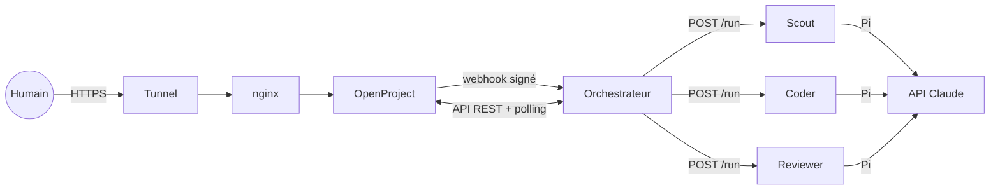
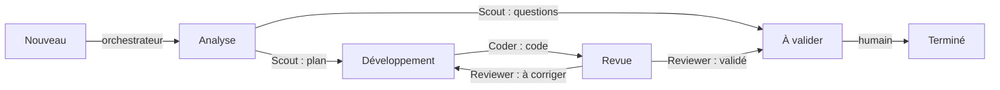

# Ferme d'agents IA sur OpenProject

Une petite équipe de développement composée d'**un humain et de trois agents IA**, qui travaillent ensemble dans
un outil de gestion de projet du marché ([OpenProject](https://www.openproject.org/)). L'humain décrit un besoin,
les agents l'analysent, écrivent le code et le relisent, puis l'humain valide.

**Sommaire** · [Partie 1 : la démo en bref](#partie-1--la-démo-en-bref) ·
[Partie 2 : dossier technique](#partie-2--dossier-technique) ·
[Installation](#installation) · [Exploitation](#exploitation)

---

# Partie 1 : la démo en bref

*Cette partie ne demande aucune connaissance technique.*

## L'idée

On demande souvent à une IA de répondre à une question isolée. Ce projet montre autre chose : **des agents IA
intégrés à la façon de travailler d'une équipe**, dans un outil que l'équipe utilise déjà, avec des rôles clairs
et un humain qui garde la main.

Chaque agent est un membre de l'équipe avec son propre compte, comme un collègue :

| Agent | Son rôle, comme dans une vraie équipe |
| --- | --- |
| 🔎 **Scout** | L'analyste : il reformule le besoin, liste ses hypothèses et propose un plan. S'il manque une information, il pose la question à l'humain au lieu d'inventer. |
| 💻 **Coder** | Le développeur : il écrit le code en suivant le plan, puis corrige ce que le Reviewer lui signale. |
| ✅ **Reviewer** | Le relecteur : il vérifie le code (erreurs, sécurité, cas oubliés) et le renvoie au Coder ou le transmet à l'humain. |

## Le parcours d'une demande

1. **L'humain crée une tâche** dans OpenProject, par exemple « une fonction qui valide un numéro de SIRET ».
2. **Le Scout** l'analyse et publie un plan en commentaire.
3. **Le Coder** écrit le code et l'envoie en revue.
4. **Le Reviewer** le relit. S'il trouve un problème important, il renvoie la tâche au Coder, au plus trois fois.
5. **L'humain** reçoit une notification, relit l'ensemble et clôt la tâche.

À tout moment, l'humain peut interpeller un agent en commentaire (« @Coder, ajoute des tests ») : l'agent répond
sans faire avancer la tâche. Chaque intervention se lit dans l'historique de la tâche, signée par l'agent concerné.

## Ce que la démo met en avant

- **L'humain décide.** Les agents proposent, l'humain valide. Les agents ne peuvent faire avancer une tâche que
  vers les étapes prévues pour eux, et seul l'humain peut la clore.
- **Les coûts sont maîtrisés.** Chaque intervention est chiffrée et enregistrée. Un budget est fixé à l'avance :
  à 80 % les agents ne s'enchaînent plus seuls, à 100 % ils s'arrêtent.
- **Le système ne s'emballe pas.** Les agents ne se répondent jamais entre eux en boucle, et le nombre
  d'interventions par tâche est plafonné.
- **La sécurité est pensée dès le départ.** Les agents n'ont accès à rien d'autre qu'au texte qu'on leur
  transmet, et le serveur n'expose aucun port sur Internet.
- **Rien n'est spécifique à un fournisseur d'IA.** Les agents utilisent aujourd'hui Claude d'Anthropic, mais
  chacun peut passer à un autre modèle, y compris un modèle installé en local, par simple configuration.

## Compétences mobilisées

| Domaine | Dans ce projet |
| --- | --- |
| Architecture logicielle | Un service central (l'orchestrateur) qui coordonne trois agents indépendants et un outil existant |
| Intégration d'IA générative | Rôles et consignes de chaque agent, format de réponse contrôlé, gestion des erreurs du modèle |
| Fiabilité | Détection des changements par deux voies complémentaires, sans doublon ni perte silencieuse |
| Sécurité | Isolement réseau, conteneurs en lecture seule, signatures, protection contre la manipulation des agents |
| Maîtrise des coûts | Chiffrage de chaque appel, budget avec paliers, rapprochement avec la facturation réelle |
| Observabilité | Traçage de bout en bout de chaque intervention, journal d'exécution |
| Déploiement | Docker Compose, publication HTTPS par tunnel sans port entrant, mode développement local |

---

# Partie 2 : dossier technique

## Architecture



| Service | Technologie | Rôle |
| --- | --- | --- |
| **OpenProject** | Image officielle tout-en-un (PostgreSQL inclus) | Seule interface utilisateur : tâches, statuts, commentaires, mentions |
| **Orchestrateur** | Python 3, FastAPI, asyncio, httpx, SQLite | Toute la logique : détection des changements, routage, contexte, publication, coûts |
| **Agents** ×3 | Serveur HTTP en bibliothèque standard Python autour du CLI [Pi](https://pi.dev) | Exécutent un modèle, sans outil, sans session, sans accès à OpenProject |
| **nginx** | nginx | Proxy inverse : en-têtes transmis, limitation de débit sur `/login` |
| **Jaeger** | Jaeger v2, profil `apm` optionnel | Visualisation des traces OpenTelemetry |

## Workflow

Chaque statut appartient à un agent. Un agent ne peut demander que les transitions prévues pour lui.



L'enchaînement n'est pas codé en dur : quand le Scout passe la tâche en *Développement*, ce changement de statut
est détecté comme n'importe quel autre et déclenche le Coder. Un humain qui déplace la tâche à la main produit
exactement le même effet.

## Détection des changements

Le webhook et le polling ne transportent qu'une information : « la tâche X a peut-être changé ». Seule une relecture
par l'API, comparée au dernier état connu, produit des événements.

1. **Webhook** (`POST /webhook`) : signature HMAC vérifiée en temps constant, puis l'identifiant de la tâche est mis
   en file et la réponse `202` est immédiate. Le contenu du webhook n'est jamais utilisé tel quel.
2. **Polling** toutes les 30 s : il rattrape ce que le webhook a manqué (redémarrage, livraison perdue). Il lit les
   tâches modifiées depuis un curseur stocké en SQLite, avec 5 s de recouvrement.
3. **Synchronisation** : un worker relit la tâche et son historique, puis compare avec la table `wp_state`. Il en
   déduit trois types d'événements : `wp_created`, `status_changed` et `comment`, un par nouveau commentaire.
4. **Déduplication** : chaque événement a une clé (`comment:981`, `status:42:3:17`…) insérée par `INSERT OR IGNORE`.
   Le webhook et le polling peuvent donc signaler dix fois la même tâche sans effet. La clé d'un changement de statut
   inclut la `lockVersion`, pour qu'une tâche qui revient dans un statut déjà vu soit bien traitée.
5. **Bootstrap** : au premier démarrage, l'existant est enregistré sans produire d'événement. Brancher
   l'orchestrateur sur un projet déjà rempli ne relance donc aucun agent.

## Routage

Le routage est une fonction pure ([router.py](orchestrator/app/router.py)), testable sans OpenProject.

| Règle | Déclencheur | Action |
| --- | --- | --- |
| R1 | Tâche créée en *Nouveau* | Passage en *Analyse* |
| R2 | Statut *Analyse*, *Développement* ou *Revue* | Lancement du Scout, du Coder ou du Reviewer (mode *étape*) |
| R3, R4 | Commentaire humain qui mentionne un ou plusieurs agents | Le premier agent mentionné répond (mode *réponse*, sans changer le statut) |
| R5 | Commentaire écrit par un agent ou par l'orchestrateur | Ignoré : c'est la protection contre les boucles |
| R6 | Commentaire sans mention d'agent | Ignoré |
| R7 | Statut sans agent | Ignoré |

L'état du budget module ces règles : à 80 %, seules les mentions déclenchent un agent ; à 100 %, plus rien ne part.

## Exécution d'un agent

1. **Concurrence** : un verrou asyncio par tâche garantit une seule exécution à la fois par tâche, et un sémaphore
   limite à 3 les exécutions simultanées. Après l'attente du verrou, la tâche est relue : si son statut a changé
   entre-temps, l'événement est abandonné.
2. **Contexte borné** ([context.py](orchestrator/app/context.py)) : la description (4 000 caractères au plus), un
   résumé cumulé des interventions, les 6 derniers commentaires (8 000 caractères au plus) et la dernière intervention
   complète de l'agent « en face » (le Coder voit le Reviewer, et inversement). Les données de la tâche sont placées
   entre balises `<donnees_tache>`, avec la consigne de ne pas exécuter d'instruction qu'elles contiennent.
3. **Appel** : l'orchestrateur appelle `POST /run` sur le service de l'agent, qui lance
   `pi --mode json --no-tools --no-session --no-extensions --no-mcp --offline …` et lit le flux d'événements JSONL
   pour récupérer la réponse et la consommation de tokens.
4. **Contrat de sortie** : l'agent doit répondre par un objet JSON `{comment, next_status, summary}`. Une sortie
   invalide est redemandée une fois avec une consigne corrective, puis la tâche passe en *Bloqué* avec l'explication.
5. **Publication** ([publisher.py](orchestrator/app/publisher.py)) : le commentaire est publié **avec le compte
   OpenProject de l'agent**, pour que l'historique soit bien attribué. La transition n'est appliquée que si elle figure
   dans la liste blanche de l'agent. Le workflow OpenProject du rôle *Agent* forme une seconde barrière (réponse 422).
   Les écritures de statut utilisent le verrouillage optimiste d'OpenProject (`lockVersion`, nouvel essai sur 409).
6. **Coût** : les tokens remontés par Pi sont valorisés avec [pricing.json](orchestrator/pricing.json), cumulés en
   SQLite et publiés sur une tâche de suivi dédiée.

## Garde-fous

| Garde-fou | Valeur par défaut |
| --- | --- |
| Exécutions d'agent par tâche | 10, puis la tâche passe en *Bloqué* |
| Cycles de revue Reviewer → Coder | 3, puis la tâche part à l'humain avec les remarques restantes |
| Exécutions simultanées | 3 |
| Durée maximale d'une exécution | 300 s |
| Budget de la démo (`DEMO_BUDGET_USD`) | Alerte à 50 %, mentions seules à 80 %, arrêt à 100 % |
| Plafond par agent côté Anthropic | Un workspace et une limite de dépense par agent, indépendants de l'orchestrateur |

Avec une clé admin, un rapprochement quotidien compare le cumul de l'orchestrateur avec l'API *Cost Report*
d'Anthropic et publie l'écart.

## Sécurité

- **Aucun port entrant** : le site est publié par un tunnel qui n'ouvre que des connexions sortantes, par exemple
  Tailscale Funnel. Le TLS est terminé en amont de nginx, qui n'est joignable que depuis l'hôte.
- **Isolement réseau** : les agents sont sur un réseau Docker `internal` et ne peuvent pas joindre OpenProject. Le
  webhook passe par le réseau interne, vers une IP fixe explicitement autorisée par la protection SSRF d'OpenProject.
- **Conteneurs durcis** : système de fichiers en lecture seule, `cap_drop: ALL`, `no-new-privileges`.
- **Webhook signé** : HMAC vérifié avec `hmac.compare_digest`.
- **Injection de prompt** : données délimitées et déclarées comme non fiables, agents sans aucun outil, transitions
  sur liste blanche. Un agent manipulé ne peut que publier un commentaire et demander une transition autorisée.
- **Moindre privilège** : un compte OpenProject et une clé API Anthropic par agent.

## Observabilité

- **Traces OpenTelemetry** exportées vers Jaeger. Le `traceparent` est propagé de l'orchestrateur jusqu'au service
  de l'agent, et chaque appel au modèle produit un span `llm.call` avec les attributs `gen_ai.*`.

  ```
  event.receive
  ├── routing.decide
  ├── context.build
  ├── agent.run
  │   └── POST /run → pi.run → llm.call ×n
  ├── cost.record
  └── openproject.publish
  ```

- **Journal d'exécution** : un fichier JSONL par jour, conservé 30 jours, avec le contexte envoyé, la réponse brute,
  la consommation et l'identifiant de trace.
- **Preflight** : `python -m app.preflight` vérifie les comptes, le projet, les statuts, la tâche de suivi, les agents,
  les tarifs et la clé admin.

## Choix techniques et compromis

| Choix | Pourquoi | Limite assumée |
| --- | --- | --- |
| Webhook **et** polling | Réactivité du premier, garantie du second, sans doublon grâce à la déduplication | Un aller-retour de statut A → B → A entre deux synchronisations n'est pas vu |
| Événement marqué traité dès son émission | Simplicité | Sémantique *at-most-once* : un plantage pendant le traitement perd l'événement. Passer en *at-least-once* demanderait des publications idempotentes |
| SQLite | Un seul processus, un seul écrivain, un état petit | Pas de mise à l'échelle horizontale en l'état |
| File asyncio en mémoire | Suffisant pour une démo | Une vraie file (Redis, RabbitMQ) avec accusé de réception serait nécessaire au-delà |
| Agents sans outil | Surface d'attaque minimale, coût prévisible | Le code produit n'est ni exécuté ni commité : c'est une démo de collaboration, pas un pipeline CI |
| Pi plutôt qu'un SDK | Changement de fournisseur ou de modèle par configuration, nouvelles tentatives et suivi des tokens inclus | Une dépendance de plus à suivre |
| Budget vérifié au routage | Simple et lisible | Le coût n'est connu qu'après l'exécution : avec 3 exécutions en parallèle, le budget peut être dépassé de 3 exécutions au plus. Le plafond par workspace Anthropic couvre ce cas |

## Modèle

Les trois agents utilisent **Claude Haiku 5.5** d'Anthropic (`claude-haiku-5-5`, supporté au moins jusqu'au
7 octobre 2027) : un fournisseur, un modèle, un tarif. Pi connaît ce modèle nativement, donc
`agent/pi/models.json` ne le déclare pas. `AGENT_THINKING` règle l'effort de réflexion (`off` par défaut).

Pi n'est lié à aucun fournisseur. Chaque agent peut utiliser un autre modèle, y compris d'un autre fournisseur cloud
ou un modèle local (Ollama ou tout serveur compatible OpenAI). Déclarez le fournisseur et le modèle dans
`agent/pi/models.json` si Pi ne les connaît pas, puis réglez `MODEL` et `PROVIDER` (par défaut `anthropic`) de l'agent
dans `docker-compose.yml`. Un modèle local ne coûte rien au token : donnez-lui des tarifs à zéro dans
`orchestrator/pricing.json`.

> [!WARNING]
> Pour changer de modèle, modifiez `MODEL_SCOUT` / `MODEL_CODER` / `MODEL_REVIEWER` dans `.env` et ajoutez le tarif
> du modèle par million de tokens dans `orchestrator/pricing.json`, puis passez `verified` à `true`. Sans tarif, le
> preflight échoue et les exécutions ne sont pas décomptées du budget. Ne redéclarez pas dans `agent/pi/models.json`
> un modèle que Pi connaît déjà : l'entrée remplacerait sa définition (gestion de la réflexion, tarifs par tranches).

## Structure du dépôt

```
agent/           service agent : serveur HTTP (bibliothèque standard Python) autour du CLI Pi
prompts/         consignes système des 3 agents
orchestrator/    webhook, polling, routage, contexte, publication, suivi des coûts
nginx/           proxy inverse (HTTP derrière un tunnel en production, TLS autosigné en développement)
```

## Installation

1. **Serveur** : n'importe quel VPS Linux avec Docker et docker compose, SSH par clé, et un pare-feu sans aucun port
   entrant, sauf SSH restreint à votre IP.
2. **Publication HTTPS** : nginx écoute en HTTP sur le port 80, sans port publié sur Internet. Placez devant lui un
   tunnel qui termine le TLS et n'ouvre que des connexions sortantes, par exemple
   [Tailscale Funnel](#publication-avec-tailscale-funnel).
3. **Configuration** : `cp .env.example .env`, puis renseignez au minimum `OPENPROJECT_HOST` (votre nom d'hôte
   public), `OPENPROJECT_SECRET_KEY_BASE` (`openssl rand -hex 64`) et `WEBHOOK_SECRET` (`openssl rand -hex 32`).
   La ligne `COMPOSE_FILE` de `.env.example` active le [mode développement](#mode-développement) : supprimez-la, ou
   remplacez-la par celle de la [publication avec Tailscale Funnel](#publication-avec-tailscale-funnel).
   Les autres clés viennent aux étapes 5 et 6.
4. **Premier démarrage, OpenProject seul** :
   ```bash
   docker compose up -d openproject nginx
   ```
   Le premier démarrage prend quelques minutes (création de la base). Connectez-vous ensuite avec `admin` / `admin`
   et changez le mot de passe.
5. **Configuration d'OpenProject** (en tant qu'administrateur) :
   1. **API** : dans Administration > API et webhooks, vérifiez que l'API REST et les jetons d'API sont activés.
   2. **Statuts** : dans Administration > Lots de travaux > Statut, créez ceux qui manquent parmi `Nouveau`,
      `Analyse`, `Développement`, `Revue`, `À valider`, `Terminé` et `Bloqué`. L'orchestrateur les retrouve par leur
      nom, sans tenir compte de la casse ni des accents.
   3. **Utilisateurs** : créez 4 utilisateurs, `Scout`, `Coder`, `Reviewer` et `Orchestrator`. Leur nom d'affichage
      est ce que les humains tapent après `@` pour les mentionner.
   4. **Rôles et workflow** : créez un rôle `Agent` qui peut voir les lots de travaux, ajouter des commentaires et
      modifier les lots de travaux. Dans Administration > Lots de travaux > Workflow, autorisez-lui uniquement les
      transitions des agents : Analyse → Développement / À valider, Développement → Revue,
      Revue → Développement / À valider. L'orchestrateur a besoin d'un rôle qui peut passer n'importe quelle tâche
      en `Analyse` et en `Bloqué`, et les humains des autres transitions (par exemple À valider → Terminé).
   5. **Projet** : créez le projet dont l'identifiant est `OPENPROJECT_PROJECT` (`demo-agents` par défaut). Ajoutez
      comme membres les 3 agents avec le rôle `Agent`, l'orchestrateur et les humains.
   6. **Clés d'API** : connectez-vous avec chacun des 4 utilisateurs, allez dans Mon compte > Jetons d'accès,
      générez un jeton d'API et copiez-le dans `OP_KEY_SCOUT`, `OP_KEY_CODER`, `OP_KEY_REVIEWER` et
      `OP_KEY_ORCHESTRATOR`.
   7. **Tâche de suivi** : dans le projet, créez une tâche (par exemple « Suivi du crédit des agents ») et mettez son
      identifiant dans `OPENPROJECT_TRACKING_TASK_ID`. L'orchestrateur y enregistre le coût de chaque exécution et
      les alertes de budget. Aucun agent n'est jamais lancé sur cette tâche.
   8. **Webhook** : dans Administration > API et webhooks > Webhooks, ajoutez un webhook avec l'URL
      `http://172.28.10.10:8000/webhook` (l'IP fixe de l'orchestrateur sur le réseau Docker interne, autorisée par
      `OPENPROJECT_SSRF__PROTECTION__IP__ALLOWLIST`), la valeur de `WEBHOOK_SECRET` comme secret, les événements
      des lots de travaux et des commentaires, et uniquement le projet de démo.
6. **Claude Platform** :
   1. Créez un workspace par agent, chacun avec sa propre clé d'API (`ANTHROPIC_KEY_SCOUT`, `ANTHROPIC_KEY_CODER`,
      `ANTHROPIC_KEY_REVIEWER`) et une limite de dépense. Cette limite vous protège même si le suivi de budget de
      l'orchestrateur échoue.
   2. Réglez `DEMO_BUDGET_USD`, le budget suivi par l'orchestrateur.
   3. Facultatif, comptes organisation uniquement : créez une clé admin (`ANTHROPIC_ADMIN_KEY`) et listez les
      identifiants des 3 workspaces, séparés par des virgules, dans `ANTHROPIC_WORKSPACE_IDS`. Cela active le
      rapprochement quotidien avec l'API *Cost Report*.
   4. Vérifiez les tarifs dans `orchestrator/pricing.json`, puis passez `verified` à `true`.
7. **Démarrage complet et vérification** :
   ```bash
   docker compose up -d --build
   docker compose exec orchestrator python -m app.preflight
   ```
   Le preflight affiche ✅ ou ❌ pour chaque point. Pour tester de bout en bout, créez une tâche au statut `Nouveau`
   dans le projet : elle passe en `Analyse` et le Scout répond en moins d'une minute.

### Publication avec Tailscale Funnel

Vous pouvez publier nginx avec [Tailscale Funnel](https://tailscale.com/kb/1223/funnel). La surcouche
`docker-compose.tailscale.yml` publie nginx sur l'interface locale de l'hôte uniquement. Activez-la avec
`COMPOSE_FILE=docker-compose.yml:docker-compose.tailscale.yml` dans `.env`, fournissez votre propre configuration nginx
dans `nginx/tailscale/conf.d/` (non incluse dans ce dépôt), puis lancez sur l'hôte
`tailscale funnel --bg http://127.0.0.1:80`.

## Mode développement

Le mode développement fait tourner toute la pile en local, ou sur un serveur joint par son IP, sans tunnel :
nginx sert le HTTPS sur le port 443 avec un certificat autosigné.

1. Activez la surcouche de développement dans `.env` (déjà présente si vous avez copié `.env.example`) :
   ```bash
   COMPOSE_FILE=docker-compose.yml:docker-compose.dev.yml
   ```
   Sous Windows, docker compose sépare les fichiers par `;` par défaut : utilisez `;` ou ajoutez
   `COMPOSE_PATH_SEPARATOR=:`.
2. Réglez `OPENPROJECT_HOST` sur le nom d'hôte que vous taperez dans le navigateur (`localhost` ou l'IP du serveur).
   OpenProject refuse les requêtes adressées à tout autre nom.
3. Générez le certificat autosigné (le dossier `nginx/dev/certs/` est ignoré par git) :
   ```bash
   mkdir -p nginx/dev/certs
   openssl req -x509 -newkey rsa:2048 -nodes -days 365 -subj "/CN=localhost" \
     -keyout nginx/dev/certs/dev.key -out nginx/dev/certs/dev.pem
   ```
4. Suivez les étapes 4 à 7 de l'installation, puis ouvrez `https://localhost`
   et acceptez l'avertissement de certificat. Le webhook passe par le réseau Docker interne : il fonctionne de la même
   façon en développement.

**Traçage (facultatif)** : passez `OTEL_SDK_DISABLED=false` dans `.env` et démarrez Jaeger avec
`docker compose --profile apm up -d`. L'interface écoute sur `127.0.0.1:16686`. Sur un serveur distant, joignez-la
avec `ssh -L 16686:localhost:16686 <serveur>`. Chaque exécution apparaît comme une trace, de l'événement reçu jusqu'à
l'appel de l'agent et la publication dans OpenProject.

## Exploitation

| Tâche | Commande |
| --- | --- |
| Vérifier la configuration | `docker compose exec orchestrator python -m app.preflight` |
| Logs de l'orchestrateur (décisions de routage) | `docker compose logs -f orchestrator` |
| Logs d'un agent | `docker compose logs -f coder` |
| Journal d'exécution | `docker compose exec orchestrator sh -c 'tail -n 5 /app/logs/runs-*.jsonl'` |
| Remettre l'état à zéro (compteurs, coûts) | `docker compose stop orchestrator && docker volume rm agents-openproject_orch_data` |

Le nom du volume est préfixé par `agents-openproject`, le nom de projet compose défini dans `docker-compose.yml`.
